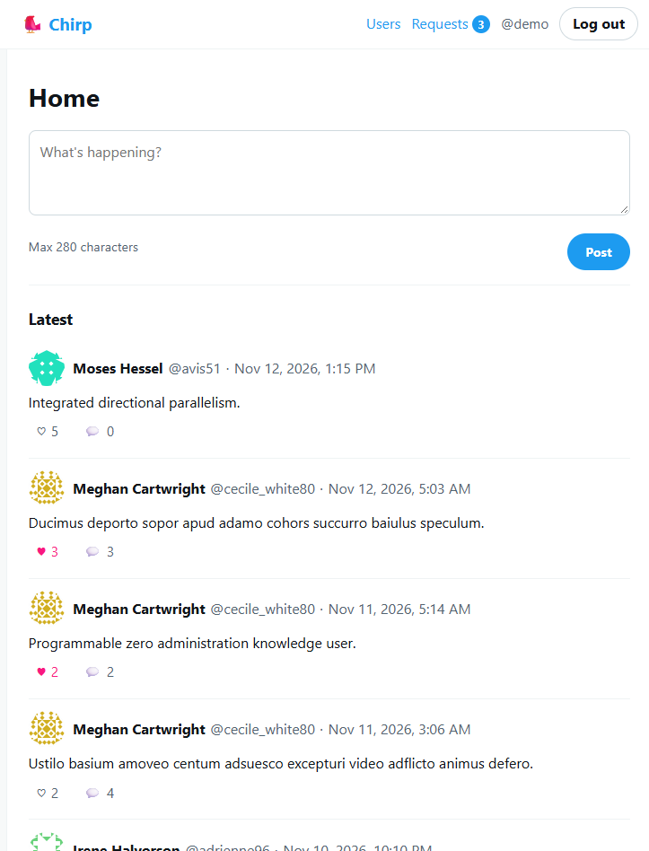
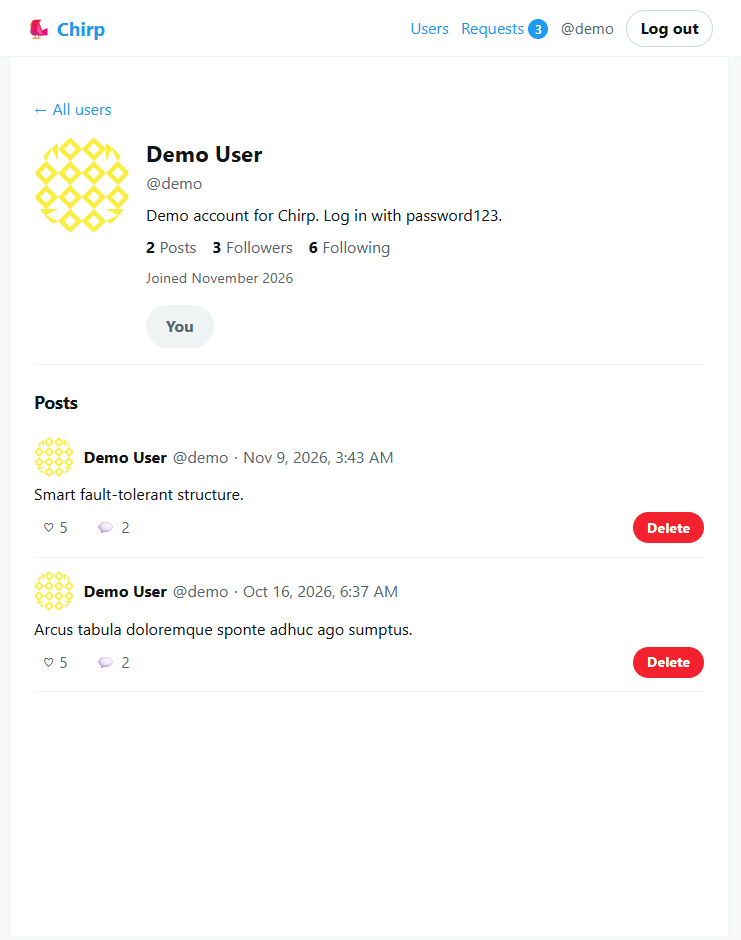
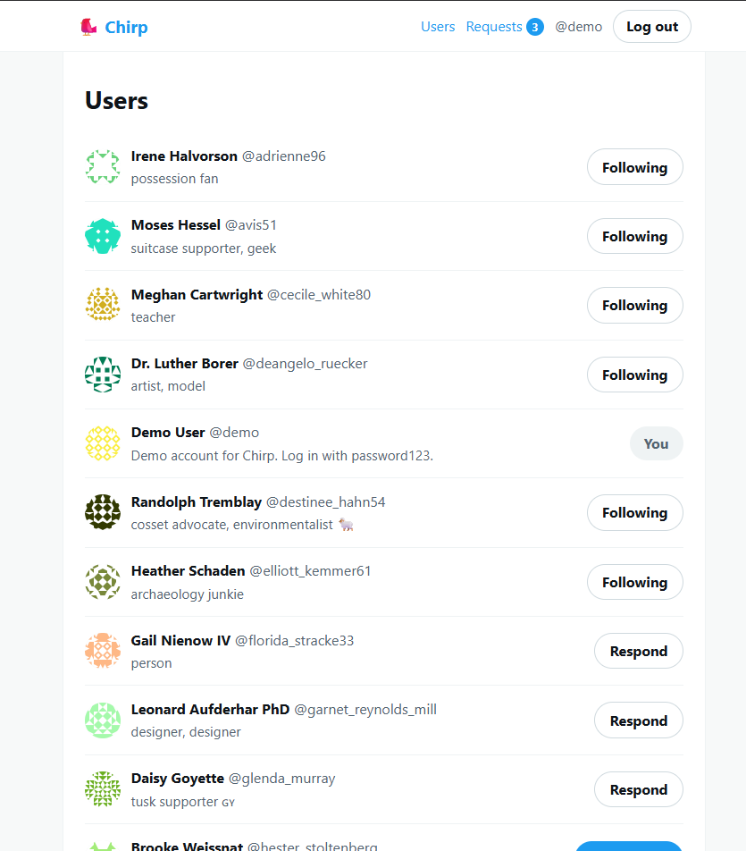
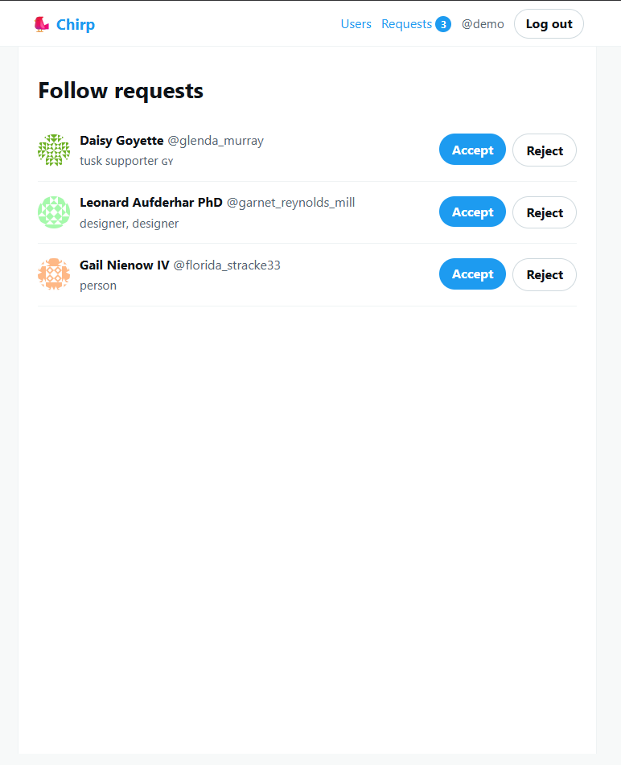
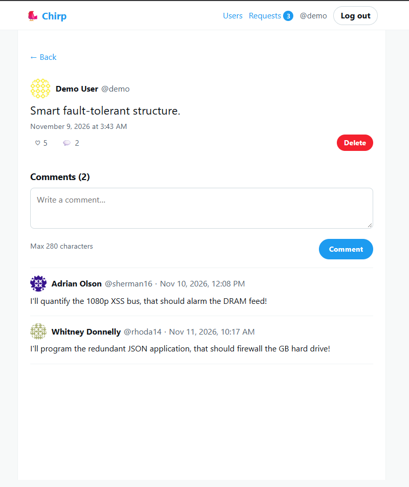

# 🐦 Chirp

A minimal Twitter clone: text posts, follow requests with approval, likes and comments. Server-rendered with Express, TypeScript, Prisma and EJS. Built as a portfolio project for The Odin Project.

**Live demo:** LIVE_URL_HERE
**Demo login:** username `demo`, password `password123`

> The demo runs on free hosting tiers (a free web service and a free database that both sleep when idle), so the first request after a quiet period can take up to a minute to load.

## Screenshots

| Feed | Profile |
|---|---|
|  |  |

| Users and follow buttons | Follow requests |
|---|---|
|  |  |

| Post detail | Mobile |
|---|---|
|  |  |

## Features

- Sign up, log in and log out, with sessions that persist in Postgres
- Every route redirects to `/login` unless you are signed in (only `/login` and `/signup` are public)
- Text posts (max 280 characters): create, view and delete your own
- Likes (one per user per post, toggle) and comments (delete your own)
- Follow requests: send a request, the other person accepts or rejects, and either side can unfollow
- Feed of your posts plus posts from people whose follow request was accepted, 10 per page
- `/users` directory with the right button for each relationship: Follow, Requested, Following, Follow Back, Respond, You
- Profiles with Gravatar avatars, bio, counts and that user's posts
- Responsive layout for phones, tablets and desktops

## Tech stack

Node.js, Express, TypeScript (strict), PostgreSQL, Prisma, passport-local, bcrypt, express-session with connect-pg-simple, Zod, EJS, plain CSS, and @faker-js/faker for seed data. Deployed on Render (web service) with a Neon Postgres database.

## Security

- bcrypt (cost 12); password hashes are never logged or returned
- Session cookie is `httpOnly`, `sameSite=lax` and `secure` in production; the secret comes from the environment
- CSRF token on every state-changing form
- All input validated with Zod; post and comment length limits enforced on the server
- Authorization checked on the server for every delete, like, comment and follow response
- Output is HTML-escaped by EJS; redirects after like and follow only accept same-site paths

## Run it locally

You need Node.js 20+ and Docker.

```bash
git clone https://github.com/Drv2709/chirp.git
cd chirp
cp .env.example .env
# put a random value in SESSION_SECRET:
node -e "console.log(require('crypto').randomBytes(32).toString('hex'))"

npm install
docker compose up -d
npx prisma migrate dev
npx prisma db seed
npm run dev
```

Open http://localhost:3000 and log in as `demo` / `password123`. Every seeded user shares the password `password123`; the seed script prints their usernames.

## Scripts

| Command | What it does |
|---|---|
| `npm run dev` | Start the dev server with reload |
| `npm run typecheck` | Type-check without emitting files |
| `npm run build` | Generate the Prisma client and compile to `dist/` |
| `npm start` | Run the compiled server |
| `npx prisma migrate dev` | Create and apply a migration locally |
| `npx prisma db seed` | Reset and re-create the demo data |

## Deployment (Render + Neon)

1. Create a Neon project and copy its **direct** (non-pooled) connection string.
2. In Render, choose New, then Blueprint, and select this repository (`render.yaml` describes the web service). Paste the Neon connection string when Render asks for `DATABASE_URL`. `SESSION_SECRET` is generated automatically.
3. Migrations run automatically on every start. To load the demo data into the hosted database, run the seed locally against the Neon connection string:

```bash
DATABASE_URL="<neon connection string>" NODE_ENV=production SEED_CONFIRM=yes npx prisma db seed
```

Health checks: `/healthz` (the server is up) and `/healthz/db` (the database is reachable).

## Project docs

- [docs/PLAN.md](docs/PLAN.md): data model (ERD), follow state machine and page map
- [docs/PROGRESS.md](docs/PROGRESS.md): build log, phase by phase